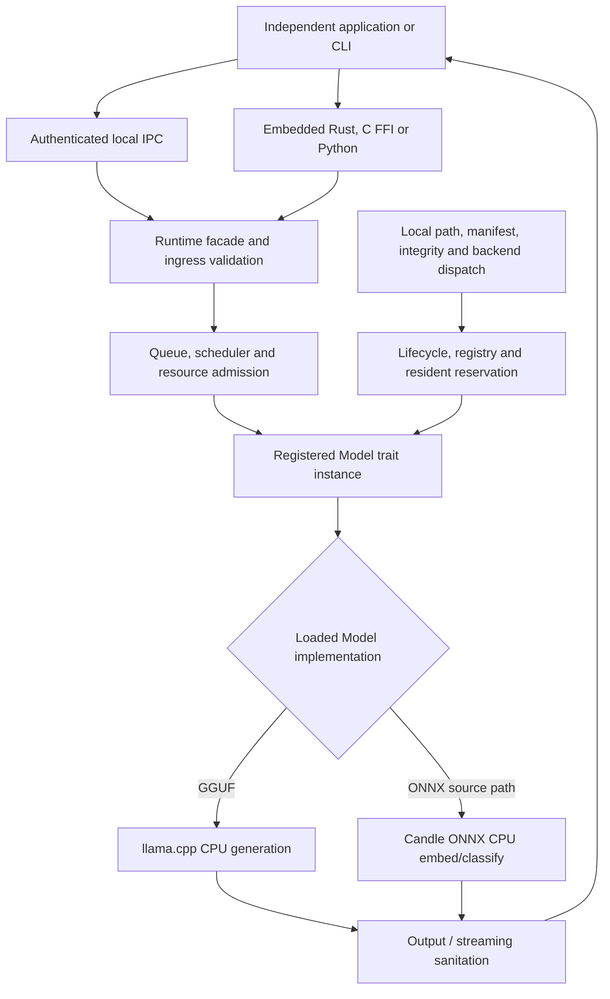
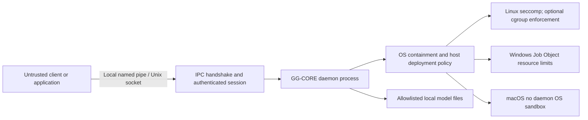

# GG-CORE Runtime Architecture

**Status:** Standalone product and trust-boundary audit updated 2026-11-14 against `main@1032d1b`; the published `v0.10.0-rc.1` baseline remains distinct from unmerged v1 development. Source, [SECURITY.md](../../SECURITY.md), [IPC schema](../IPC_PROTOCOL_SCHEMA.md), and the [release gate #130](https://github.com/MythologIQ-Labs-LLC/GG-CORE/issues/130) take precedence over older diagrams. Consumer-specific producer contracts are subordinate, not GG-CORE's product architecture.
**Companion docs**: `docs/CONCEPT.md` (the "why"), `docs/ARCHITECTURE_PLAN.md` (file-tree
contract + interface specs), the ADRs in `docs/architecture/`. Where this doc and the code
disagree, the code wins — fix this doc.

GG-CORE (**Greatest Good — Contained Offline Restricted Execution**) is a **standalone, offline-first local inference runtime**. It performs model execution under platform-specific security and resource controls. It is not a desktop UI, agent decision-maker, tool executor, plugin, cloud router or CoreForge-specific compute service. Any application, including a future CoreForge consumer, may use the same documented local interfaces.

GG-CORE does **not** impose full OS isolation by itself on every platform. Windows Job Objects restrict process and resource usage but are not a filesystem/network sandbox; macOS has no daemon sandbox; embedding into an application inherits that application's authority.

## 1. C.O.R.E. design principles

| Principle | Meaning |
|-----------|---------|
| **Contained** | Managed daemon's process and resource controls depend on OS: Linux seccomp, Windows Job Object limited to process/resources, macOS no sandbox. In-process embedding has no daemon containment. |
| **Offline** | GG-CORE has no network inference/download service. A complete network deny is not provided on Windows/macOS without host controls. |
| **Restricted** | IPC-only communication with authenticated callers — named pipes / Unix sockets; no HTTP/REST/WebSocket/localhost ports. |
| **Execution** | Pure compute — no business logic, no decision authority. |

Philosophy: resource-aware, multi-tenant triage ("Greatest Good for the Greatest Number") that
prioritizes system stability over any individual request.

## 2. Security boundaries

| Boundary | Rule |
|----------|------|
| Process | Daemon: Linux seccomp filter; Windows Job Object resource/process limits, **not AppContainer**; macOS no sandbox. Embedded mode executes with the host application's authority. |
| Filesystem | Model loading enforces physical path confinement and optional manifest hash, not OS-level deny-all filesystem access on every platform. |
| Network | IPC only in GG-CORE; OS/network isolation requires separate deployment enforcement on Windows/macOS. |
| IPC | Named pipes / Unix sockets only. No HTTP/REST/WebSocket/localhost ports. |

**Forbidden modules** (their presence signals scope creep): `auth/`, `vault/`, `synapse/`,
`plugins/`, `network/`. **Forbidden dependencies**: `reqwest`, `hyper`, WebSocket libs, filesystem
-traversal libs.

## Current architecture drawings (published boundary)

These are **runtime architecture**, not a CoreForge application diagram. The first graph separates the model-loading control path from the inference path; the second shows the security/containment boundary and the important limits of a local process.





Neither drawing claims an HTTP listener, remote model fetching, tool execution, universal filesystem/network isolation, GPU execution, or automatic switching in the released RC. Windows network isolation and least-privilege filesystem access remain host responsibilities.

## 3. Crate shape (consumable dependency)

`core-runtime/Cargo.toml` declares `crate-type = ["rlib", "cdylib"]`. GG-CORE is consumable four ways
from a single build:
- **Rust rlib** — embed `gg_core` directly in any compatible local host.
- **C ABI (cdylib)** — the C header `core-runtime/include/gg_core.h` (cbindgen) over
  `core-runtime/src/ffi/`.
- **Python (PyO3)** — `core-runtime/src/python/` (feature `python`).
- **Standalone daemon + CLI** — `core-runtime/src/main.rs` and `core-runtime/src/cli/` (serve, model lifecycle, inference and diagnostics).

## 4. Module map (`core-runtime/src/`)

| Module | Responsibility | Key files |
|--------|----------------|-----------|
| `ipc/` | Authenticated framed IPC, request dispatch, cancellation and release status | `ipc/server.rs`, `ipc/handler.rs`, `ipc/protocol_types.rs`, `ipc/server_release.rs` |
| `scheduler/` | Priority queue, batching, worker pool | `scheduler/queue.rs` (`RequestQueue`), `scheduler/priority.rs` (`PriorityQueue` = `BinaryHeap`) |
| `engine/` | Inference, tokenizer, streaming, unified model trait, MoE | `engine/model.rs` (`Model` trait), `engine/inference.rs`, `engine/stream_*` |
| `models/` | Local model admission, registry, backend dispatch, held-instance release tracking and versioning | `models/backend_dispatch.rs`, `models/lifecycle.rs`, `models/lifecycle_release.rs`, `models/model_ops.rs` |
| `memory/` | Buffer pool, GPU, KV cache, prompt cache, paged/arena | `memory/pool.rs` (`MemoryPool`), `memory/kv_cache.rs`, `memory/prompt_cache.rs` |
| `security/` | Ingress prompt-injection scan + egress PII sanitize | `security/pipeline.rs` (`SecurityPipeline`), `security/stream_sanitizer.rs` |
| `sandbox/` | Process sandboxing (seccomp/cgroup, unix-gated) | `sandbox/mod.rs`, `sandbox/unix*.rs` (`#[cfg(unix)]`) |
| `telemetry/` | Prometheus metrics, OpenTelemetry spans | `telemetry/` |
| `ab_testing/` | Traffic splitting + per-variant metrics | `ab_testing/` |
| `shim/` | Veritas shim: rate-limit + service-tier | `shim/rate_limiter.rs`, `shim/service_tier.rs` |
| `ffi/` | C FFI bindings (cdylib) | `ffi/mod.rs`, `ffi/models.rs` |
| `python/` | PyO3 bindings (feature `python`) | `python/mod.rs`, `python/session.rs` |
| `cli/` | Standalone serve/infer, authentication, health, model load/unload and release-wait commands | `cli/`, `cli_parser.rs` |
| `deployment/`, `k8s/` | Deployment descriptors / K8s integration surfaces | `deployment/`, `k8s/` |

The public API is `core-runtime/src/lib.rs`; the secure product façade is
`core-runtime/src/runtime_facade.rs`.

## 5. The secure inference path (load-bearing invariant)

`Runtime::infer` / `Runtime::infer_stream` (`runtime_facade.rs`) is the **sole external inference
entry point**. Every call runs the security pipeline:

```
Runtime::infer(prompt)
  → SecurityPipeline::scan_prompt(prompt)        # ingress: prompt-injection scan (block on risk)
  → InferenceEngine::run*(...)                    # pub(crate) — not reachable externally
  → SecurityPipeline::sanitize_output(output)     # egress: PII redaction
      (streaming: security/stream_sanitizer.rs re-releases only settled, sanitized text)
```

`InferenceEngine::{run, run_cancellable, run_cancellable_with_memory_limit, run_stream_sync}` are
`pub(crate)` (B-33): a consumer **cannot** bypass the `SecurityPipeline`. This is why GG-CORE is
a guarded model-compute façade, **not** a guarantee of absolute prompt-injection defense, OS sandboxing or safe downstream use. See `docs/META_LEDGER.md` (B-33 seal) for the historical implementation record. Security depends on the selected deployment boundary.

## 6. Model dispatch (GGUF / ONNX)

`models/backend_dispatch.rs` `load_model_dispatch` selects the backend from a sibling
`manifest.json` next to the model file: ONNX when the manifest declares it, else the GGUF default.
Both backends are unified behind the `engine::Model` trait (`engine/model.rs`), so the engine
registry holds `Arc<dyn Model>` and streaming/non-streaming backends coexist (ONNX has no token
streaming). Production callers (FFI `ffi/models.rs`, Python `python/session.rs`) route through
`load_model_dispatch` — GGUF and ONNX are servable end-to-end (B-29).

## 7. Scheduler & memory

- **Scheduler** (`scheduler/`): `RequestQueue` wraps a `PriorityQueue` (a `BinaryHeap`, O(log n)
  push/pop, FIFO-stable within a priority) in an async `tokio::Mutex` + `Notify`. Priorities:
  Low/Normal/High/Critical. The queue op's cost is dominated by the async lock/notify, not the heap
  (B-37 measured ~0.55 µs/roundtrip, depth-insensitive).
- **Memory** (`memory/`): `MemoryPool` is a `parking_lot::Mutex<VecDeque<Vec<u8>>>` buffer pool
  (real reuse); `kv_cache` for paged KV; `prompt_cache` for exact + longest-prefix KV reuse
  (`find_prefix` is O(n), B-38). Resource limits gate concurrent memory.

## 8. Observability & degraded mode

- `telemetry/` exports Prometheus-format metrics and OpenTelemetry span data over the existing local runtime surface; GG-CORE does not open an HTTP scrape endpoint.
- Under resource pressure the runtime degrades intentionally and explainably (context reduction
  before hard-fail) rather than failing opaquely (`engine/degraded_mode.rs`, B-07).

## 9. Governance

The historical QoreLogic A.E.G.I.S. records and `docs/META_LEDGER.md` capture earlier research, plans, audits and source evidence. Current protected-main integration and standalone v1 release decisions require the specific owner-approved gates in [#161](https://github.com/MythologIQ-Labs-LLC/GG-CORE/issues/161). Follow the Section 4 Razor limits and maintain `docs/FEATURE_INDEX.md` as source-to-test evidence, without confusing source-verified features with installed-product acceptance.

---

**Unmerged v1 path:** `models/transition.rs` on `feat/v1-cold-switch-policy-20261113-no-ci` has Windows in-process evidence. Authenticated switch IPC frames, reconnect-safe status journal and `loaded_unverified` reporting are on `feat/v1-switch-ipc-20261114-no-ci` and have **no native qualification yet**. The published RC and current `main` do not expose them as a supported daemon switch. Task-specific smoke/readiness and repeated-cycle resource tests are open in [#137](https://github.com/MythologIQ-Labs-LLC/GG-CORE/issues/137).

See [current workflow and release boundaries](WORKFLOW_AND_RELEASE_BOUNDARIES.md). `docs/ARCHITECTURE_PLAN.md` is a historical file-tree and interface-plan record, not independent evidence of current implementation maturity. Update architectural claims against source and qualifying receipts.
