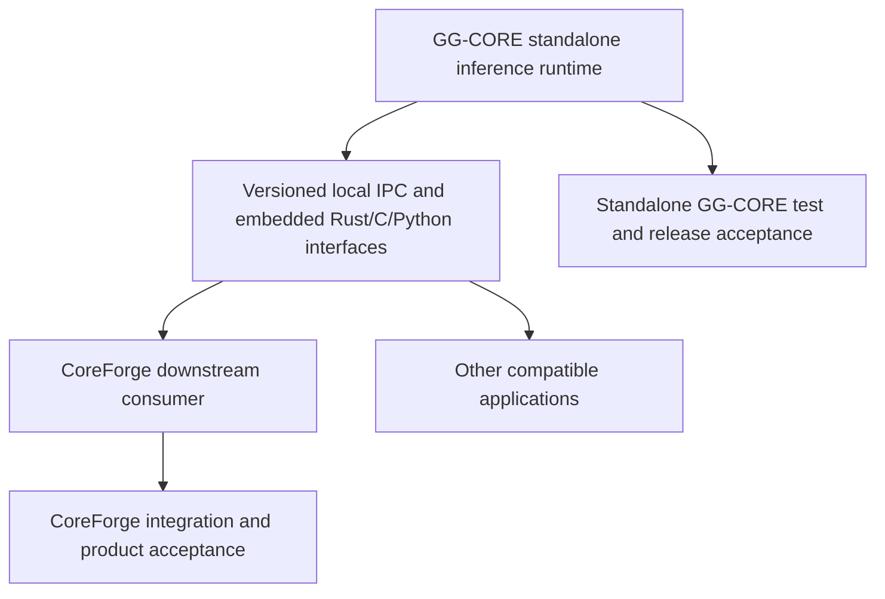

# Standalone runtime dependency direction

**Authority:** Owner direction, 2026-11-14. Applies to current GG-CORE architecture, releases, build instructions, tests, docs, and new feature plans. Supersedes early references to the "CoreForge CORE Runtime" where those references describe present ownership or dependency. Historical audits and downstream integration receipts retain their original dates and context.

## Invariant

**GG-CORE is the independent upstream inference runtime. CoreForge is one optional downstream consumer of GG-CORE.**

- **GG-CORE owns:** the inference engine and model backends, model loading and lifecycle, authenticated local IPC, Rust/C/Python interfaces, resource controls, security boundaries, tests, platform/build support, portable artifacts, signing, and the standalone version/release gate.
- **CoreForge owns:** its own application UI, workflow/persona logic, user experience, process supervision and installed-product choices. It can consume a GG-CORE version through a documented contract. Other applications have the same opportunity.
- **Dependency is one way:** `CoreForge → GG-CORE`. The reverse `GG-CORE → CoreForge` is **not** permitted as a build-time, runtime, product-scope, integration-test, or release-blocking dependency.
- **No release coupling:** a GG-CORE release candidate must install, authenticate, load a permitted model, infer, report status, and be qualified **without** CoreForge code, configuration, installation or presence. A CoreForge adoption test is performed in the consumer's release flow, not as a prerequisite for the GG-CORE upstream release.
- **No implied network API:** GG-CORE uses authenticated local named pipes or Unix sockets, not HTTP/REST/WebSocket, cloud provider routing or automatic downloads. Any downstream host can choose its own external providers independently.

Arrows describe *GG-CORE interfaces provided to consumers*. The dependency direction, expressed as imports/consumption, is **CoreForge depends on GG-CORE**, never the reverse. CoreForge has no authority to approve, publish, or change GG-CORE releases.

## Documentation and evidence scope

| Surface | Rule |
| --- | --- |
| README, architecture, quickstarts, current runbooks | Describe GG-CORE's standalone product first, with CoreForge only as an example downstream consumer where useful |
| `CLAUDE.md` and current agent prompts | No CoreForge build, UI, installer, persona, version pin, or acceptance requirement in the GG-CORE workstream |
| `docs/integration/COREFORGE_PRODUCER_CONTRACT.md` | Historical/consumer-specific *GG-CORE-to-CoreForge* contract; supplementary, not canonical standalone architecture |
| Historical reports, governance records, dated security and performance evidence | Preserve the original project terminology for traceability, and prefix a supersession note if readers could mistake it for current ownership or support |
| RC0.10.0, current main, development branches | Keep published, merged and unmerged capabilities separate. Do not attribute an unmerged switch implementation to an existing release |
| Future standalone v1 candidate | Verify independent startup, authenticated IPC, actual model/task support, lifecycle and platform gates, and Windows GG-CORE-owned executable/DLL code signing; CoreForge remains out of scope |

**Architecture source:** [Runtime architecture](CORE_RUNTIME_ARCHITECTURE.md). **Build and release source:** [Workflow boundaries](WORKFLOW_AND_RELEASE_BOUNDARIES.md). **Owner v1 acceptance:** [#161](https://github.com/MythologIQ-Labs-LLC/GG-CORE/issues/161).

This contract controls current product language, not the historical facts in archived records.
