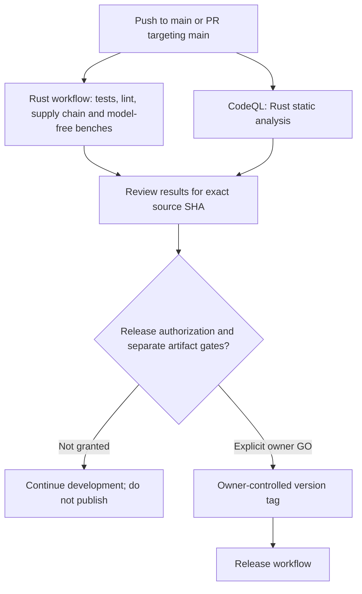
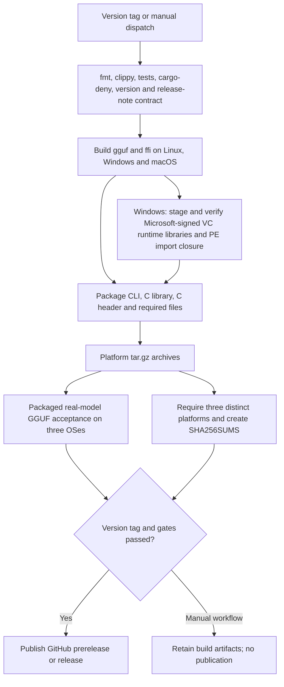

# GG-CORE CI, packaging and release boundaries

**Checked against:** protected `main@1032d1ba8a229b6690209d4661cba6706a721ea7`, 2026-11-14. This is a factual map of the current workflow files, **not** a CI execution receipt or an approval to publish. The published [`v0.10.0-rc.1`](https://github.com/MythologIQ-Labs-LLC/GG-CORE/releases/tag/v0.10.0-rc.1) is dated 2026-11-05 and immutable. The v1.0.0 standalone feature and signing gate are separate.

## Existing CI triggers

| Source | Trigger | What it actually proves |
| --- | --- | --- |
| [`.github/workflows/rust.yml`](../../.github/workflows/rust.yml) | Push to `main`, pull request targeting `main` | Three-OS default fmt/clippy/tests; Linux feature legs `gguf`, `onnx`, `ffi`, `python`, `advanced`; supply-chain cargo-deny; model-free bench and a **cache-conditional** PR gross regression check |
| [`.github/workflows/codeql.yml`](../../.github/workflows/codeql.yml) | Push to `main`, pull request targeting `main` | Rust CodeQL autobuild and analysis; **no** installed real-model, OS sandbox or release acceptance claim |
| [`.github/workflows/release.yml`](../../.github/workflows/release.yml) | Manual `workflow_dispatch` or version tag `v*` | Build/validate the three platform archives with `gguf,ffi`; published release only on tag. Manual dispatch does **not** publish. The opt-out `qualify=false` applies only to manual runs |
| `docs/integration/` native VM evidence | Manually recorded on review branches | Exact-source source tests and, when explicitly reported, real-model acceptance. No automated guarantee simply because a branch was pushed |

A green default Rust job does **not** prove GPU acceleration, broader model compatibility, an installed signed product, or a native model-switch transition. A pull request may start paid GitHub Actions under repository settings; isolated `*-no-ci` branches do not trigger the listed workflows by name alone.

## Current tag-release workflow

The packaged real-model gate uses a pinned Qwen2.5-0.5B GGUF fixture. Passing this gate does not certify other model families, CUDA/Metal, dynamic model switching or ONNX installed serving. A clean Windows Sandbox acceptance run is separate from testing on a pre-provisioned hosted runner.

## Explicit v1 Windows signing gap

**Current release YAML does not Authenticode-sign GG-CORE-owned `gg-core-cli.exe` or `gg_core.dll`.** Its checks for the redistributed Microsoft VC++ runtime DLLs are important, but their publisher signatures do not sign GG-CORE itself. Do not infer signing from the archive's SHA-256 checksums or from Windows PE import auditing.

The approved standalone v1 release requirement is to sign GG-CORE's Windows executable and DLL under an authorized organizational publisher identity, verify certificate chain and timestamp, and package/hash **the signed bytes**. If an installer is included, sign it too. Keep signing keys in a protected credential boundary and retain the original Microsoft signatures on app-local VC runtime dependencies.

**Promotion rule:** until this is implemented, independently audited and verified on the installed Windows package, the current tag-triggered workflow **must not be used to publish a purported Windows-signed v1 candidate**. An owner-controlled release decision and a fail-closed release implementation are still required. This document does not alter the live workflow or silently add a signing stage.

## Development tree versus release artifacts

- `main@1032d1b`: qualified #195 deterministic prefill, #193 memory-ceiling fail-closed behavior, #183 model-release wait/lifecycle changes, **not yet released as v1**.
- Switching source branch `feat/v1-cold-switch-policy-20261113-no-ci@a319303`: reported offline Windows real-model **in-process** A→B→A; no released IPC switch.
- Switch IPC extension `feat/v1-switch-ipc-20261114-no-ci@9be59e5`: authored authenticated request/status and bounded idempotency journal, **not yet compiled or native-qualified**. Reporting `loaded_unverified` is not operational readiness.
- Capability branch `feat/v1-backend-capability-contract-20261113-no-ci@80fd2ac`: qualified source-level read-only capability snapshot; deliberately declares no release-qualified cells.
- Published `v0.10.0-rc.1`: pinned, immutable CPU-GGUF portable archives from November 5. Keep its acceptance receipts distinct from new branch-level work.

Related gates: [standalone switching #137](https://github.com/MythologIQ-Labs-LLC/GG-CORE/issues/137), [v1 capability disposition #160](https://github.com/MythologIQ-Labs-LLC/GG-CORE/issues/160), [v1 release #161](https://github.com/MythologIQ-Labs-LLC/GG-CORE/issues/161), and [release baseline #130](https://github.com/MythologIQ-Labs-LLC/GG-CORE/issues/130).

**No CoreForge integration, HTTP listener, default remote model downloads or new automation belongs to this standalone release diagram.**
